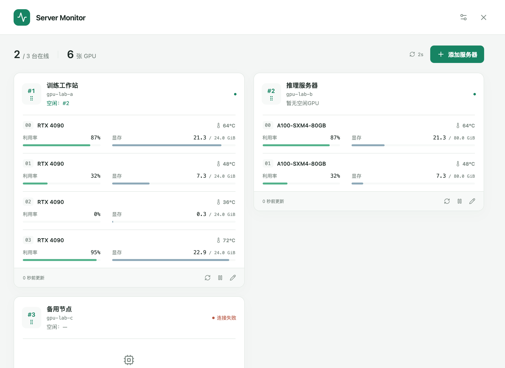

# Server Monitor

简洁的 macOS 多服务器 GPU 菜单栏监控。通过本机已有的免密 SSH 连接 Linux 服务器，查询 NVIDIA GPU 利用率、显存与温度，无需安装远端监控服务。

## 来源与许可

基于 [NVSmiBar](https://github.com/xyhacker404/NVSmiBar)，保留完整 Git 历史和原作者 Xingyu Hu 的 MIT 许可。采用的上游提交：`7d56394265d0dadd75fe5b19fe8da229dbdb6218`。

本项目沿用 Go / Wails v2 / React / TypeScript 及菜单栏交互，增加多服务器独立采样、汇总、配置持久化与中文界面。使用独立应用标识，不从上游自动更新。

## Git

- `main`：本项目开发分支；`upstream`：NVSmiBar 源仓库。
- `origin`：本项目 GitHub 仓库 `FlyingMark77/Server-Monitor`。
- 源码与锁文件入库；安装包、依赖、本地配置、日志和密钥不入库。
- 推送 `v*` 版本标签后，Actions 自动测试、按标签版本打包并发布 Release（DMG 与 SHA-256）。测试或构建失败时不会发布。完整历史保留上游作者提交。
- 发布示例：`git tag -a v0.1.3 -m "Release v0.1.3"`，然后 `git push origin main v0.1.3`。只推送本项目标签，不使用 `--tags` 上传继承的上游标签。

首版目标为 Apple Silicon / macOS 12+；Windows 适配随后补充。

## 使用

1. 将 `ServerMonitor.app` 放到 Applications 后打开，或直接打开构建输出中的应用。
2. 点击“添加服务器”，勾选 `~/.ssh/config` 中已有的免密连接；也可手动填写 SSH 别名。应用不会自动连接未选中的服务器。
3. 菜单栏按服务器编号显示空闲卡数，例如“#1 2空闲 · #2 0空闲”；点击查看弹窗或总览，卡片上显示对应编号和空闲卡编号。拖动卡片左上角的编号手柄可排序，松开后自动保存；也可聚焦手柄并按 Alt + ↑/↓ 调整。每台服务器可暂停、重试、编辑或移除。
4. 设置中可切换 1/2/5/10 秒刷新与跟随系统／浅色／深色主题。关闭窗口继续监控，“退出应用”停止采样。

远端需有可用的 `nvidia-smi`。首次连接请先在终端核对主机指纹并确认 `ssh <别名> nvidia-smi` 能免交互运行。SSH Agent、钥匙串、跳板机及自定义端口沿用系统配置；手动端口留空时不会覆盖别名的 Port。

空闲判定为显存占用 **< 0.5 GB** 且利用率 **< 5%**，按当前样本计算。GB 使用十进制（500,000,000 字节，约 476.84 MiB），按 `nvidia-smi` 原始 MiB 数值比较，不使用界面四舍五入后的值。缺失指标不算空闲；离线、过期或暂停时不沿用旧的空闲卡数。服务器从 #1 开始按保存顺序编号，拖动后编号随顺序更新；暂停不改变其他服务器编号。

## 开发与验收

- [构建、打包与测试](docs/TESTING.md)
- [架构与平台边界](docs/ARCHITECTURE.md)
- [当前验证记录](docs/VERIFICATION-0.1.1.md)

配置保存在 `~/Library/Application Support/ServerMonitor/config.json`，不属于本仓库。开发时可用 `SERVER_MONITOR_CONFIG` 指定独立配置文件；正式使用无需设置。没有联网遥测、云端账号或远端部署步骤。
